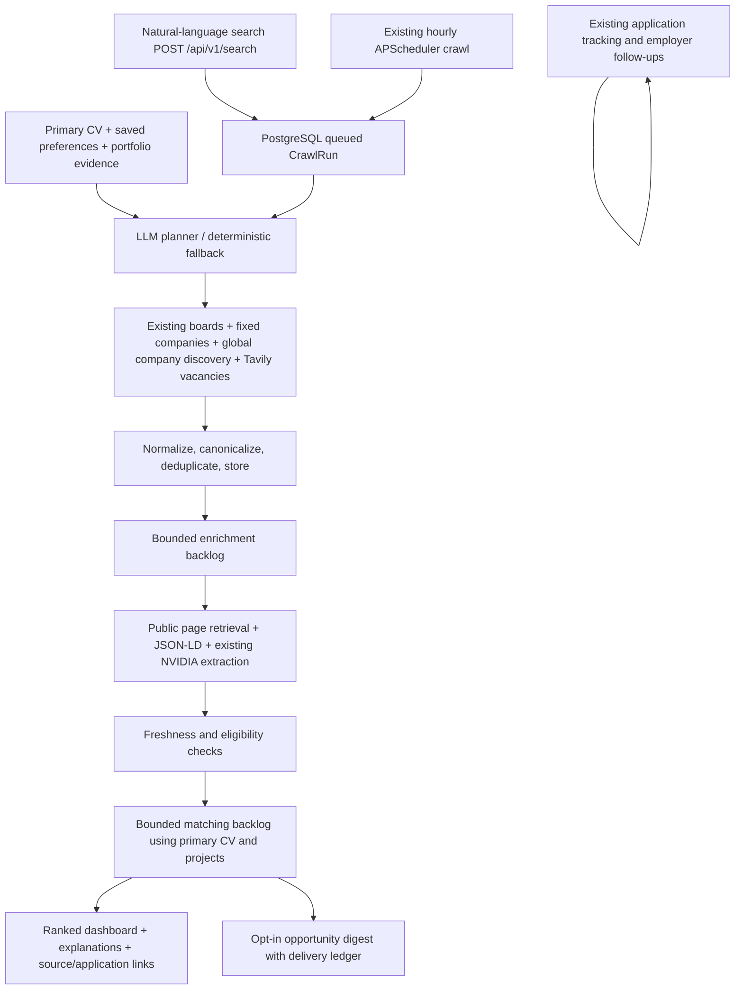

# ApplyPilot upgrade report

Completed source implementation: 23 October 2026 (Asia/Karachi).

Project: `C:\Users\khawa\Downloads\job automation`

## Delivery status

The upgrade is implemented in the existing project. Automated regression checks,
frontend compilation and lint, browser interaction checks with mocked APIs, and a
live Remotive smoke test passed. It is **not yet deployment-validated**: Docker was
unavailable and the configured PostgreSQL service could not be reached. The new
migration has been generated and checked as SQL, but has **not been applied** to
the user's database. PostgreSQL advisory-lock behavior across real workers and
paid NVIDIA/Tavily integrations remain unverified in this environment.

No real email was sent. Existing environment files and uploaded CVs were not edited.
A source snapshot was saved before implementation under the chat's `work` folder,
excluding secrets, dependency directories and uploaded resume storage. The source
directory is not a Git repository.

## 1. Improvements

- Added natural-language discovery that queues real source searches, independently
  of the legacy hourly opt-in switch.
- Extended CV extraction with projects, technologies, portfolio/GitHub links and
  candidate preference hints. Users review suggestions and explicitly save them.
- Added editable role, skill, employment-type, seniority, geography, remote-country,
  exclusion, freshness and search-depth preferences.
- Added bounded portfolio retrieval, cached refresh, robots checks, response-size
  limits, public-address validation and redirect validation. Search planning and
  matching include retrieved portfolio evidence.
- Added an LLM search planner with deterministic fallback queries, role variants,
  internship/entry-level intent, multiple locations, remote-only intent and recency.
- Added Tavily discovery of individual vacancy URLs, freshness search operators,
  source limits and a cooldown for recently unsuccessful queries.
- Preserved all existing job board and company adapters. Dynamic company discovery
  now works globally; fixed Lahore companies retain their regional selection.
- Unified manual and automatic enrichment, with JSON-LD taking precedence where
  available, explicit verification states, posting/deadline metadata, application
  links, remote restrictions, required/preferred skills and responsibilities.
- Added canonical URL/source identity deduplication and normalized company/title/
  location fingerprints. Later-discovered duplicates are marked without deleting
  their IDs or application history.
- Added bounded enrichment/scoring backlogs, retry delays, CV/job context hashes,
  primary-CV score consistency and estimated-fit explanations with project evidence.
- Added PostgreSQL advisory locks, durable queued/running/completed run records,
  cancellation checkpoints, interrupted-run recovery and source-level failures.
- Added dashboard search history, status, automatic refresh, freshness information,
  seniority/location/viewed/applied filters and a default relevant-results view.
- Added opt-in candidate opportunity digests, separate from employer follow-ups,
  with threshold/frequency controls and a delivery ledger to prevent repeat sends.
- Fixed frontend effect lint errors, added the missing frontend Dockerfile, and
  added Chromium installation to the backend Docker image definition.

## 2. Updated architecture



The existing stack remains FastAPI, PostgreSQL, SQLAlchemy, Alembic, APScheduler,
Next.js and React Query. No vector database, Redis, Celery or new queue service was
introduced. Existing NVIDIA-backed AI services are reused.

## 3. End-to-end search

1. The user uploads/parses a CV, selects a primary CV, and reviews discovery
   preferences. New CV uploads do not overwrite explicitly configured preferences.
2. The user submits a natural-language request. `POST /api/v1/search` persists a
   queued run and returns HTTP 202. The existing `/crawl/run` endpoint remains.
3. APScheduler processes queued work every 15 seconds. A per-user database lock
   prevents search and backlog overlap. A queue lock coordinates API workers.
4. Saved portfolio URLs refresh within the cache policy. The planner combines
   candidate evidence, stored preferences and current intent into bounded queries.
5. Source adapters execute live requests. One source failure does not discard
   successful sources. Unauthorized/rate-limited responses are not immediately retried.
6. Source results are stored as candidates, with provenance and discovery timestamps.
   Search-result presence alone never marks a job active or verified.
7. A separate minute-based task enriches and scores bounded batches, including old
   unscored jobs. JSON-LD and explicit page evidence populate metadata. Unknown
   information remains unknown; closed/expired/incompatible jobs are excluded.
8. Matching uses the primary CV, projects, portfolio evidence and preferences.
   Content hashes identify stale scores after relevant CV or job changes.
9. The dashboard refreshes automatically, ranks estimated fit, and exposes concerns,
   freshness, original posting links and application links.
10. Separately, every 15 minutes the notification task checks explicit opt-in,
    SMTP configuration, saved preferences, frequency, match threshold, recent
    verification and delivery history before sending a candidate digest.

## 4. Database migration

Migration: `backend/alembic/versions/b7c8d9e0f123_discovery_upgrade.py`

Parent: `a6f3c0d9b218`.

Additions:

| Table | Added fields |
|---|---|
| `users` | JSONB `preferences`, `portfolio_data` |
| `jobs` | JSONB `research`, indexed `canonical_url`, indexed `fingerprint` |
| `matches` | JSONB `details`, `context_hash` |
| `crawl_runs` | JSONB `plan`, text `intent` |
| `opportunity_deliveries` | New per-user/per-job delivery ledger with unique constraint |

The `research` document contains first discovery, last seen, posting/deadline,
verification/state, content hashes, provenance, eligibility, application URL and
viewed metadata. Existing IDs, foreign keys, application history and APIs remain.
Existing extraction status values remain compatible; detailed enrichment states
are recorded separately in `research.enrichment_state`.

No existing tables or user data are deleted by the upgrade migration. The
downgrade removes new fields and therefore is not a data-preserving rollback for
information created after the upgrade.

## 5. Preserved functionality

- Registration/login and existing authentication routes.
- PDF/DOCX resume management and primary resume selection.
- Manual URL/text job ingestion and re-extraction.
- Adzuna, RemoteOK, Remotive, Jobicy and Tavily integrations.
- Arbisoft, WamoLabs, Workable, SuccessFactors and generic Playwright scraping.
- Match explanations, cover-letter and resume-bullet generation.
- Application tracking and status history.
- Connected SMTP accounts, test email flow and employer follow-up automation.
- Existing dashboard, manual crawler endpoint and scheduled crawl opt-in.

Regression tests exercise representative paths and route registration. This is
not a claim that every external service or production workflow was live-tested.

## 6. Validation results

| Check | Result |
|---|---|
| `python -m unittest discover -s tests -q` | 49 tests: **47 passed, 2 skipped** |
| Live Remotive contract smoke test | **Passed** |
| Live Tavily/paid tests | Not executed; explicit opt-in gate |
| Backend import and OpenAPI generation | Passed; 47 routes / 30 OpenAPI paths at check time |
| Python compile check | Passed |
| `alembic upgrade head --sql` | Passed through new head; SQL generated |
| PostgreSQL migration execution | Not run: database unavailable |
| `tsc --noEmit` | Passed |
| `npm run lint` | Passed |
| `npm run build` | Passed; all application routes compiled |
| Browser UI smoke with mocked APIs | Passed: dashboard, search, cancellation, settings, project save; no page errors |
| Real SMTP sends | None |

The database pipeline tests use isolated SQLite databases with JSONB compilation
adapted for tests. They validate service behavior, not PostgreSQL-specific locking
or migration execution. Lock ownership/release paths are unit-tested with mocks.
One upstream Starlette/AnyIO deprecation warning appeared in the test run.

## 7. Deployment and configuration

Start PostgreSQL and take a database backup before migration. From the backend:

```powershell
.\venv\Scripts\python.exe -m alembic upgrade head
.\venv\Scripts\python.exe -m playwright install chromium
.\venv\Scripts\python.exe -m uvicorn app.main:app --port 8010
```

From the frontend:

```powershell
npm run dev -- --port 3010
```

Required existing configuration:

- `DATABASE_URL`: reachable PostgreSQL instance.
- `JWT_SECRET`: existing stable authentication secret.
- `EMAIL_ENCRYPTION_KEY`: existing stable Fernet key; do not replace it if SMTP
  credentials are already stored.
- `NVIDIA_API_KEY`, `NVIDIA_BASE_URL` and existing extraction/parsing/scoring/
  generation model settings.
- `TAVILY_API_KEY`: required for general web vacancy/company discovery.
- `ADZUNA_APP_ID`, `ADZUNA_APP_KEY`: optional Adzuna source credentials.
- `CORS_ORIGINS`: match the actual frontend origin, e.g. `http://localhost:3010`.
- `NEXT_PUBLIC_API_URL`: e.g. `http://localhost:8010/api/v1`.

New controls and defaults:

| Setting | Default |
|---|---:|
| `SCORING_BATCH_SIZE` | 8 |
| `ENRICHMENT_BATCH_SIZE` | 8 |
| `DISCOVERY_MAX_JOBS` | 120 |
| `DISCOVERY_RUN_TIMEOUT_MINUTES` | 45 |
| `DISCOVERY_RETRY_HOURS` | 6 |
| `PORTFOLIO_REFRESH_HOURS` | 24 |
| `AI_TIMEOUT_SECONDS` | 60 |

Opportunity emails default to disabled. Users must configure SMTP and explicitly
enable them in Discovery preferences. Employer follow-up settings remain separate.

The root README and example environment now document NVIDIA, the configured local
ports, migration commands, and test commands. Existing private environment files
were preserved.

## 8. Remaining limitations

1. Apply the migration and validate real PostgreSQL worker coordination before
   deployment. Neither the migration nor multi-worker locks were runtime-verified
   against PostgreSQL here.
2. NVIDIA structured generation, Tavily and most company scrapers were tested via
   mocks rather than live credentials. Real coverage depends on source availability,
   rate limits, website structure and access restrictions.
3. Cancellation is cooperative between sources; an in-flight request or scraper
   must finish or hit its timeout before cancellation takes effect.
4. Public-address/redirect checks reduce URL-fetch risks. For public multi-tenant
   hosting, also enforce network egress restrictions against private/internal
   networks; application DNS checks alone are not a complete DNS-rebinding defense.
5. Remote eligibility is conservative string/evidence analysis, not a complete
   geography or work-authorization rules engine. Ambiguities appear as concerns.
6. Listing availability and dates cannot always be proven. Unknown results remain
   visible with uncertainty; digests require stricter verification.
7. SMTP cannot provide atomic exactly-once delivery with database commits. A
   reserved/uncertain delivery is not automatically resent, preventing duplicates
   at the cost of possibly missing a digest after an ambiguous SMTP failure.
8. Backlog scans are bounded to 1,000 jobs per user per pass, with smaller LLM
   batches. Large deployments will need database-side work selection and capacity
   tuning. Acquisition is sequential and bounded rather than a distributed crawler.
9. Candidate projects and portfolio text improve matching, but no authenticated
   GitHub repository traversal, private portfolio access or exhaustive website
   crawling is implemented.
10. Fixed-source coverage and basic country aliases are finite. LLM-planned
    free-text web search broadens coverage but does not guarantee complete results.

## 9. Deployment continuation

Deployment continuation on 23 October 2026: Docker Desktop is installed, but its
launcher exits with code 1 and reports that registry key
`SOFTWARE\Docker Inc.\Docker Desktop` cannot be found. The Docker Linux engine
pipe is absent. PostgreSQL could not be started, so no database backup, migration
application, or real PostgreSQL concurrency validation was possible. Docker
Desktop must start successfully on this Windows account before these checks can
continue. No database or Windows registry changes were made.


## Trust fixes (23 October 2026)

Shared backend recommendation gates now separate verified recommendations from uncertain
leads. Source date, vacancy and application-link checks, conservative eligibility, score
caps and cache invalidation were added. Tavily uses native date filtering and bounded
directory/ATS discovery. No additional migration or keys are needed; restart services.
70 regression tests (68 passed, 2 opt-in skipped), 17 real-PostgreSQL pipeline tests,
frontend checks and mocked-API browser checks passed. Live quality was checked on a
small sample; 90% accuracy and exclusive reliance remain unproven.

## Status-report fixes (23 October 2026, evening)

Follow-up to `ApplyPilot Status Report.docx`. Source and database were backed up first to
`Downloads\job automation backups\2026-10-23-before-fixes` (`source.tgz`, `applypilot.dump`).

- **Shared queue no longer blocks everyone.** Searches and background enrichment now run
  on small per-process worker pools (`SEARCH_WORKERS`, `BACKLOG_WORKERS`, default 3 each).
  The scheduler tick only dispatches; each user's work holds only that user's advisory
  lock, so one slow user or page no longer delays other users. A backlog pass now stops
  after `BACKLOG_PASS_SECONDS` (default 120) or as soon as that user has a queued search,
  so the user's own searches start within about two minutes. The dashboard shows
  "Waiting to start" / per-source progress instead of only "in progress".
- **Slow real-browser checks are bounded.** One Chromium instance is shared across a
  pass's renders (fresh isolated context per page) instead of launching per page, and
  at most `RENDERED_FETCHES_PER_PASS` (default 3) renders run per user per pass. Postings
  over the cap are deferred to the next pass without spending an AI call.
- **Preferences no longer go stale per job.** Each search plan records a hash of the
  eligibility-relevant saved preferences. A plan narrows eligibility only while those
  preferences are unchanged; after you edit them, older postings are judged against your
  current preferences. Plans from before this change are treated as outdated.
- **Text encoding.** Pages are decoded with their declared charset (HTTP header, then
  `<meta>`), falling back to UTF-8 then Windows-1252, instead of always UTF-8.
  Double-decoded source text (e.g. `£`, `–`) is repaired when stored.
- **Company discovery picks real careers pages.** Discovered companies start from the
  site root, careers links are ranked by path/ATS host/link text, policy/blog/login pages
  are never chosen, `/careers` and `/jobs` are tried when no link exists, and if no
  careers page is found the AI extraction is skipped rather than run on a homepage.
- **All stored postings re-checked.** `POLICY_VERSION` is now 3, which forces every
  stored posting through enrichment and rescoring under the fixed rules.
- **Damaged rows repaired.** The four Bitlogix rows collapsed by the old shared-listing
  bug were restored in place (own title and own section of the careers page) and queued
  for re-checking. No rows were deleted.

- **One bad posting no longer aborts a pass.** AI-extracted fields are clipped to their
  column widths (a long multi-currency salary overflowed `salary_range` and crashed every
  backlog pass, 19 times during the re-check), and any single posting that fails to save
  is marked failed with a retry delay while the pass continues.

New settings (optional): `SEARCH_WORKERS`, `BACKLOG_WORKERS`, `BACKLOG_PASS_SECONDS`,
`RENDERED_FETCHES_PER_PASS`. No migration is needed. Tests: 95 run, 93 passed, 2 opt-in
live tests skipped; frontend `tsc` and lint pass.

## More local sources and employer-copy lookup (23 October 2026, night)

- **Company job-board feeds.** New `app/services/job_sources/ats_feeds.py` reads the public
  JSON feeds published by Workable, Greenhouse, Lever and Ashby (no browser, real posting
  dates, structured locations, published apply links). Feeds are filtered to Pakistan
  locations and ranked by the search plan's roles/skills (whole-word match) before the
  per-source budget is applied. Registered in `crawl_service.ATS_COMPANIES`, each confirmed
  live on 23 Oct 2026: Devsinc (Workable, 32 Pakistan openings; replaces the browser
  scraper, which stays as a fallback and keeps the same job identities), Motive
  (Greenhouse, 39), Careem (Greenhouse, 6), Educative (Lever, 11), Tajir (Ashby, 2).
  Probed with no public feed or no current openings: VentureDive, Tintash, eMumba, Confiz,
  tkxel, 10Pearls, Folio3, NetSol, Techlogix, Cubix, i2c, Arpatech and others.
  Adding a company is one line: `(platform, slug, name)`.
- **Feed apply links.** A published apply link from the feed is used for the reachability
  check when the rendered page hides its apply button; it is still fetched and checked.
- **Employer copy of aggregator postings.** `app/services/original_posting.py`: for a posting
  found on Jooble/LinkedIn/beBee/Indeed/Rozee/etc. that cannot be verified there, one web
  search (`company careers title`) looks for the employer's own posting, accepting only the
  company's own domain or an ATS board URL naming the company, and following the
  employer's careers index to the matching role link. The job is then re-checked there;
  the aggregator URL is kept as `aggregator_url`. At most `ORIGINAL_LOOKUPS_PER_PASS`
  (default 2) per user per pass, once per job. On the 5 current aggregator postings it
  found no employer copy (none exists or the title is too generic) and accepted no wrong page.

Tests: 104 run, 102 passed, 2 opt-in live tests skipped.
